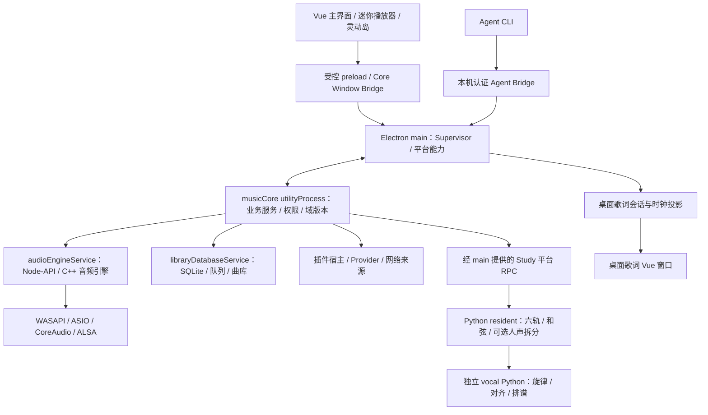

# 应用架构与演进约束

本文描述当前应用的所有权、运行边界和新增功能的接入方式。进程入口以 `electron.vite.config.ts` 为准，公共操作以 `src/shared/coreProtocol.ts` 为准；音频细节见 [音频引擎架构](./twilight-audio-engine-architecture.md)，质量要求见 [质量门禁](./quality-gates.md)。

## 总体结构

Twilight Echo 是 Electron 多进程应用，业务按领域模块组织。Core 决定播放、队列、分析任务和持久化的业务语义；宿主提供文件系统、设备、窗口和进程能力；Vue 界面与 CLI 是同一业务接口的客户端。

图中的平台 RPC 是调用方向，不是额外进程。utilityProcess 由宿主监督；Python 是独立子进程。构建入口数量不等于启动后必定常驻的进程数量。

## 模块职责

| 位置 | 职责 | 边界 |
| --- | --- | --- |
| `src/renderer/src` | 页面、交互、本地视图状态、Core 状态投影、歌词／曲谱渲染 | 不直接导入 Node、Electron 或 main 内部实现 |
| `src/preload` | 受控桥接与事件订阅 | 不承载业务状态机，不转交任意主进程对象 |
| `src/core` | 播放、队列、来源解析、插件、曲库、分析、设置等领域语义 | 只依赖 Core 和 shared；领域契约没有运行代码，平台能力显式注入 |
| `src/shared` | DTO、协议、校验、纯投影、歌词与乐理计算 | 不依赖 main／renderer，不访问浏览器或 Node 运行时 |
| `src/main/coreProcess` | Core 进程传输入口、跨进程客户端和生命周期监督 | `entry.ts` 只接线；组装由 `composition/coreHost.ts` 持有 |
| `src/main` | Electron 生命周期、授权路径、设置集成、平台能力、Python／原生服务适配 | 设备与文件操作通过受控端口提供给 Core |
| `src/main/adapters/<domain>` | 文件、网络、插件运行时与第三方 SDK 实现 | 直接使用 Node API；没有全局 I/O 注册或旧 shim |
| `src/main/composition/<domain>` | 绑定领域工厂与宿主能力 | 实例状态属于业务 owner；不通过容器查找隐式依赖 |
| `audio-engine` | 实时播放、解码、DSP、设备输出、音源交接 | 推理与排谱不得进入实时音频回调 |
| `resources/music-study` | 本地模型推理、歌词筛选、音符与谱面生成 | 接收任务执行；持久队列和是否切换音源由 Core 决定 |
| `agent-harness` | CLI 操作与结果导出 | 连接真实应用，不复制队列、账号或分析数据库 |

### 实际主进程侧构建入口

| 入口 | 源码 | 用途 |
| --- | --- | --- |
| `index` | `src/main/index.ts` | Electron 应用启动、平台集成与窗口 |
| `musicCore` | `src/main/coreProcess/entry.ts` | Node 宿主的业务 Core |
| `diagnosticWriter` | `src/main/diagnostics/writerWorker.ts` | 诊断落盘 |
| `pluginHost` | `src/main/plugins/host.ts` | 插件隔离运行 |
| `audioEngineService` | `src/main/audioEngineService.ts` | 实时音频服务 |
| `audioAnalysisService` | `src/main/audioAnalysisService.ts` | BPM／响度等离线分析池 |
| `libraryScanService` | `src/main/library/libraryScanService.ts` | 文件枚举与元数据解析 |
| `libraryDatabaseService` | `src/main/library/libraryDatabaseService.ts` | 曲库与队列数据库 |

`CoreApplication` 是领域操作入口；`CoreApplicationRuntime` 是 main 持有的应用连接；`CoreSupervisor` 管理实际进程和 epoch。三者的生命周期不同，不能通过关闭／重建某个页面来重启业务 Core。

`core/requests` 按 catalog、library、audio、plugins、sources、workspace、settings、playback、study 分发请求。每个 handler 的 payload 由操作名联合类型收窄；公共权限和输入验证仍在 `CoreApplication`。4 个播放来源准入操作由 application 前置处理，其余操作必须恰好注册一次。新增操作需同时通过 handler 完整性测试。

18 个 Core 领域工厂接收具有业务含义的构造器或操作能力；`*Port.ts`／`*Contract.ts` 仅描述结构类型。平台内部没有消费者的实现细节不另建 Core 契约。新增契约不允许包含模块注册、状态实例或宿主导入。

## 状态与通信

### 谁持有什么

- Core 持有播放意图、队列 occurrence、分析任务、来源身份、缓存租约和领域版本。
- 原生音频持有实际设备与音频时钟。Core 观察实际回报，并串行提交意图；界面不以按钮状态代替音频已生效。
- Renderer 的 `usePlayerStore` 是 Core 播放投影的入口，`useMusicStore` 是 Core 曲库查询适配；它们不是独立的播放或数据库 owner。
- 桌面歌词有独立的窗口设置、布局与平滑时钟，但演唱内容和分析控制来自应用会话。
- CLI 经认证的本机 bridge 进入同一 Core；显式路径操作仍经过文件授权。

### 四类数据

| 数据 | 当前通道 | 演进约束 |
| --- | --- | --- |
| 小型状态与域版本 | `CoreSnapshot` / `CoreClientMessage` | 保持有界；按真实域版本触发读取，普通进度变化不能刷新无关领域 |
| 控制命令 | Core command | 权限、输入校验、epoch 和 requestId 必须保留；结果未知的写操作不能自动重放 |
| 分页／结果 | Core query | 保留 revision、页码、歌曲与 epoch 的过期响应保护；大结果按内容版本复用 |
| 高频频谱／平滑时钟 | 可视化订阅、窗口时钟投影 | 不塞入整库或整份谱面；订阅由可见性、消费者与真实参数变化控制 |

目前 `changed()` 会向已连接客户端发布完整的有界 snapshot，renderer 以 shallow snapshot 替换接收。观察多个字段时使用 Vue 多 source watch 或具有值相等语义的 key，不能用每次新建数组的单 getter 代替字段比较。

`coreConnection.ts` 已有查询背压和命令优先分配；这只限制并发，不会消除重复请求。共享查询可以合并，但必须包含权限／账号／来源／epoch 等身份条件，不能跨账号复用敏感结果。

## 三条关键数据流

### 播放与切换音源

1. 页面或 CLI 提交歌曲身份与选择意图；Core 确认队列、revision 和 occurrence。
2. 来源解析器取得授权后的本地路径或在线来源，管理缓存与临时资源。
3. 播放状态机通过音频适配调用独立原生服务；设备回报进入同一控制序列。
4. Core 发布实际状态，renderer／系统播放器／桌面歌词分别投影。
5. 分轨与原曲的交接复用播放时钟，不能因切换页面或音源模式而重置歌曲时间。

队列 occurrence 与歌曲 id 不可互换：同一首歌重复出现在队列中，仍是不同播放发生。异步完成必须核对当时的 occurrence，不能激活后来切到的另一首歌。

### 分轨、和弦与曲谱

1. Core 合并重复分析请求，捕获来源、歌词出处和任务阶段。
2. Study 平台取得完整音源并验证来源／模型／算法签名。
3. 六轨产出供分轨播放、去人声和弦分析及可选多人声拆分复用。
4. 旋律和对齐由独立 vocal 环境执行，已有歌词参与对齐；AMLL 结构化主唱歌词和网易云回退歌词使用不同的前处理策略。
5. 模型结果与谱面保存后，主界面、桌面歌词与导出使用共享的歌词／乐理投影和谱面组件。

模型推理顺序由 Core 队列决定。`resident_protocol.py` 的单执行器负责执行与取消通道，不能额外建立不受 Core 控制的并行推理调度器。

状态与大结果是两个通道。摘要 `revision` 表示进度、混音等状态；`artifactRevision` 只在持久化内容改变时递增。Main 发布 runId／generation／resultRevision 元数据；Core 只在内容变化时取完整结果，事务保存后 ACK。终态 ACK 成功前保留 producer payload 和来源租约。临时保存失败会重试持久化，不重跑已完成推理。

Python 控制线程每 2 秒发送独立心跳，parent 与 vocal child 分别监督。启动上限 180 秒，warm 上限 600 秒；无进度预算为 GPU `max(180 秒, 音频秒数 × 6)`、CPU `max(600 秒, 音频秒数 × 30)`。持续心跳不能掩盖推理进度停滞。取消宽限 5 秒，进程树退出确认 10 秒；系统恢复时重置监督时钟。

故障回收仅处理本应用拥有的进程树，并核对 Windows 子进程身份。无法确认退出时保留资源并停住队列；确认退出后保存已有阶段、标记中断，再处理其他歌曲。失败歌曲需要显式重试。

### 查询与在线来源

Core 的搜索／Provider／来源解析是入口；界面使用分页结果与稳定身份。登录态、喜欢状态和网络凭据不能成为 renderer 维护的第二份权威数据。除产品明确要求的本地筛选外，应保留服务端排序和分页语义，不以拉取全部歌曲来模拟不存在的服务端分类接口。

## 持久化与缓存

| 对象 | 当前存放／所有权 | 失效依据 |
| --- | --- | --- |
| 曲库、队列、领域记录 | 独立 SQLite worker；Core 发起业务读写 | 数据库 revision、来源身份与事务 |
| 分析项目摘要与压缩 artifacts | `studyRepository.ts` 的 `projects.sqlite`；摘要写入和 artifact 提交分开 | 内容版本与哈希；状态更新不压缩谱面。一次性升级前用 SQLite 一致性备份保护现有记录 |
| 分轨音频 | Study 缓存目录；`CoreStudyAudioCache` 管理磁盘预算、预留和租约 | 签名与文件校验；按 LRU 淘汰未保护项 |
| 已加载的结果对象 | Core 128 MiB／32 项；每个 renderer 48 MiB／16 项 | 按 UTF-8 JSON 大小 × 3 估算一次；租约保护的 LRU，淘汰后从磁盘重新加载 |
| 模型依赖与权重 | 应用外可迁移运行包 | 注册表与文件哈希 |

磁盘 WAV 上限、压缩后的谱面存储量、解压后的内存对象、GPU 权重及激活内存是不同预算，不能互相替代。清理磁盘音频时要保留正在播放、分析、导出的租约；释放内存结果不应删除用户持久化的曲谱或编辑。

内存租约在异步读取前取得，覆盖当前歌曲、运行任务、下一曲、导出和编辑。受保护项可以临时超预算，此时停止额外预取，释放租约时立即淘汰。Main 只保留尚未确认的 producer 结果。Renderer 用 epoch／project id／artifactRevision 复用结果对象；进度和混音更新不重建曲谱投影，epoch 改变会清理旧缓存。

当前 Python 已实现模型预热、单推理序列、两套依赖环境、可选模型互斥驻留和空闲约 30 秒后卸载可选 GPU 权重，六轨保留。两套环境共享磁盘 PyTorch 文件，不代表两进程共享全部模型内存；不应仅为了减少进程数强行合并 NumPy／ONNX Runtime 依赖。

## 新增功能的接入方式

1. 在对应 `shared` 领域文件定义有限 DTO 和操作语义，接入公共权限与校验。
2. 业务状态机放到 `core/<domain>`，依赖范围小而明确的端口；新增平台 I/O 放到宿主适配器。
3. 在宿主组装处注入实现；业务服务不自行发现 Electron 全局对象或重建数据库。
4. 页面通过 Core store／composable 使用；本地只保留视图状态和有界缓存。
5. 更新生成的 CLI 清单；同一操作不再另建一套 CLI 业务逻辑。
6. 验证真实 revision、取消、重连、资源释放和过期响应；对高频路径测请求数／字节数和实际交互，而不以文件行数作为性能门禁。

### 生命周期与页面组装

`ShutdownSequence` 合并重复关闭，在失败的 owner 处停留，后续明确重试从该步骤继续；尚未释放进程的 owner 不允许提前关闭它依赖的存储。Core host 管理启动中断、部分初始化回收和服务关闭顺序，application 管理业务域与请求的关闭顺序。

页面保持原来的组件、布局和动效。`useAppWindowLifecycle` 负责窗口订阅，阻止异步启动在卸载后安装监听；`useCollectionAlphabet` 负责歌单定位与动画帧回收；`useStreamingViewport` 负责有界的页面滚动记忆；`usePlayingNotation` 将播放光标和按结果身份缓存的排谱分开。

### 后续重构应保持的约束

- 将任务状态版本、artifact 内容版本、混音版本与显示偏好区分，避免一次进度变化使所有数据层重做大结果处理。
- 提供按域的 selector／查询复用与资源 scope，保持现有 epoch、权限和写操作确认边界。
- 领域组装与请求分发采用显式能力和有类型约束的 handler；不要用不受校验的任意字符串反射调用。
- 页面按所有权拆分，先分离歌曲列表、播放页、分析呈现和导航控制；是否缓存页面实例由实测决定，不默认永久挂载所有页面。
- 歌词主题采用共享语义 Token 与窗口适配。桌面歌词的独立配色、字体和布局设置仍由该窗口配置决定。
- 为长任务定义无进度检测、取消确认与拥有者回收；取消尚未确认时不能释放 GPU 或文件租约，让下一任务与它重叠运行。

## 验证与发布

- 边界：`node --test scripts/core-boundaries.test.cjs scripts/architecture-boundaries.test.cjs`。门禁失败必须处理实际违规，不能提高旧依赖引用上限来通过。
- 类型：`tsconfig.core.json`、`tsconfig.node.json`、`tsconfig.web.json` 分别覆盖业务、宿主与界面。
- 行为：领域服务、跨进程客户端、真实 Vue／Electron 组件分别验证。测试通过与实际设备可播放是不同证据。
- 发布：先生产构建与依赖闭包检查，再核对实际 ASAR、原生资源和模型清单；完整包需迁移、禁网、路径及校验测试。
- 维护：入口或 owner 变化时更新本文和开发者文档。临时审查计数、性能采样与任务计划放在工作区 `.local/`，不把旧诊断记录写成长期架构事实。
